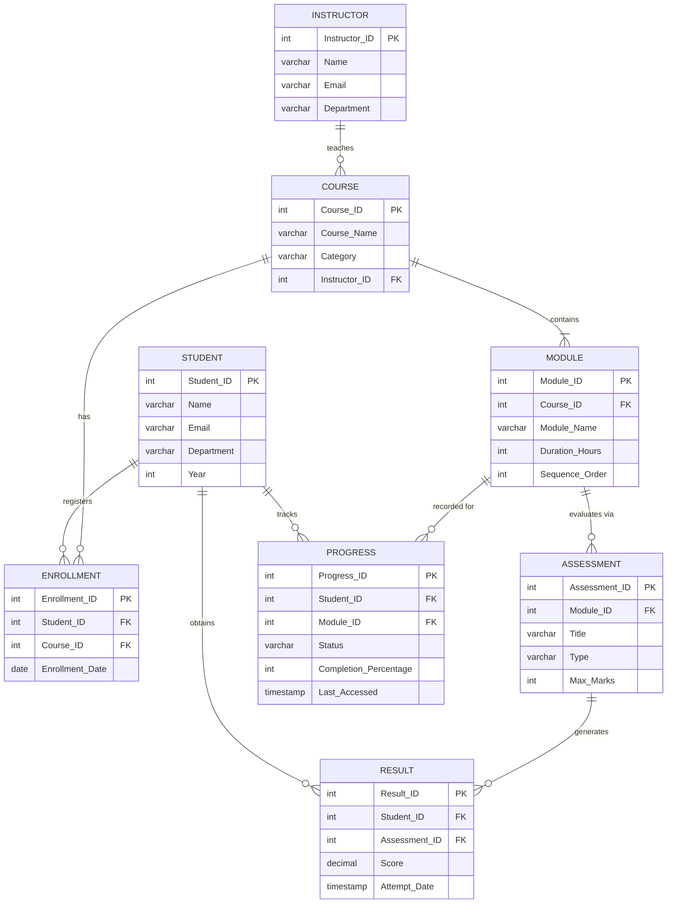

# Presentation I: Problem Statement & Conceptual Modeling
## Online Course Learning Progress Management System

**Course:** B.Tech 2nd Year — Database Management Systems (DBMS) Lab Project  
**Team Members:**
- **Siddhant Agarwal** | Roll No: `25WU0102262` | Section: `AIML Whales`
- **Manthena Naga Sri Rohan** | Roll No: `25WU0102151` | Section: `AIML Panthers`

---

### 1. Project Title
**Online Course Learning Progress Management System**

### 2. Problem Statement
Traditional educational platforms and modern e-learning ecosystems struggle to track granular student progress across modular curricula and multi-format assessments. Existing systems often suffer from:
1. **Data Inconsistency & Redundancy:** Disconnected records between enrolled courses, module completions, and assessment scores.
2. **Absence of Referential Integrity:** Orphan progress or result entries created for modules or assessments the student never registered for.
3. **Lack of Real-Time Analytics:** Faculty and course administrators cannot rapidly identify at-risk students or evaluate module-wise drop-off rates.
4. **Poor Auditability:** Inability to enforce strict business rules such as completion bounds (0% to 100%), score boundaries (0 to Maximum Marks), and unique registration constraints.

### 3. Objectives & Scope
The objective of this project is to architect, normalize, implement, and deploy an enterprise-grade Relational Database Management System (RDBMS) paired with an interactive full-stack administrative dashboard.

#### Specific Objectives:
- Model an 8-entity relational database schema enforcing 1NF, 2NF, 3NF, and BCNF.
- Guarantee ACID compliance, primary key uniqueness, foreign key referential integrity (`ON DELETE RESTRICT`), and domain constraints.
- Provide a responsive full-stack web application (React, Node.js, Express, MySQL) enabling end-to-end CRUD operations.
- Implement specialized SQL aggregation, multi-table `JOIN`, and analytical reporting queries.
- Deliver a dedicated Faculty Live Demonstration suite verifying real-time database mutations.

#### Scope of the System:
- **Student Profile Management:** Tracks student details across multiple departments (`Computer Science`, `Information Technology`, `Electronics`) and academic cohorts (Years 1, 2, and 3).
- **Instructor & Curriculum Hierarchy:** Instructors design and manage courses; courses are broken into sequential learning modules.
- **Formative & Summative Assessments:** Modules contain assessments (quizzes, coding assignments, examinations) with defined maximum marks.
- **Enrollment Governance:** Students enroll in courses with guaranteed non-duplicate registration.
- **Granular Progress Monitoring:** Module-level completion percentage tracking (0-100%) and status (`Not Started`, `In Progress`, `Completed`).
- **Performance Evaluation:** Assessment result logging with score validation and submission timestamps.

---

### 4. Identified Entities and Key Attributes

| Entity | Primary Key | Key Attributes | Foreign Key Dependencies |
| :--- | :--- | :--- | :--- |
| **`STUDENT`** | `Student_ID` | `Name`, `Email`, `Department`, `Year` | None (Strong Entity) |
| **`INSTRUCTOR`** | `Instructor_ID` | `Name`, `Email`, `Department` | None (Strong Entity) |
| **`COURSE`** | `Course_ID` | `Course_Name`, `Category`, `Instructor_ID` | `Instructor_ID` → `INSTRUCTOR` |
| **`MODULE`** | `Module_ID` | `Course_ID`, `Module_Name`, `Duration_Hours`, `Sequence_Order` | `Course_ID` → `COURSE` |
| **`ASSESSMENT`** | `Assessment_ID` | `Module_ID`, `Title`, `Type`, `Max_Marks` | `Module_ID` → `MODULE` |
| **`ENROLLMENT`** | `Enrollment_ID` | `Student_ID`, `Course_ID`, `Enrollment_Date` | `Student_ID` → `STUDENT`, `Course_ID` → `COURSE` |
| **`PROGRESS`** | `Progress_ID` | `Student_ID`, `Module_ID`, `Status`, `Completion_Percentage`, `Last_Accessed` | `Student_ID` → `STUDENT`, `Module_ID` → `MODULE` |
| **`RESULT`** | `Result_ID` | `Student_ID`, `Assessment_ID`, `Score`, `Attempt_Date` | `Student_ID` → `STUDENT`, `Assessment_ID` → `ASSESSMENT` |

---

### 5. High-Level Entity-Relationship (ER) Conceptual Architecture

---

### 6. Presentation Artifacts
- Reference Slide Deck: [`Presentation-I_Online_Course_Learning_Progress.pdf`](./Presentation-I_Online_Course_Learning_Progress.pdf)
