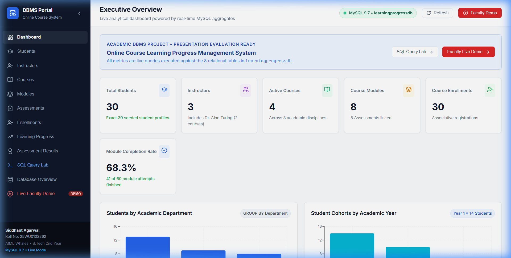
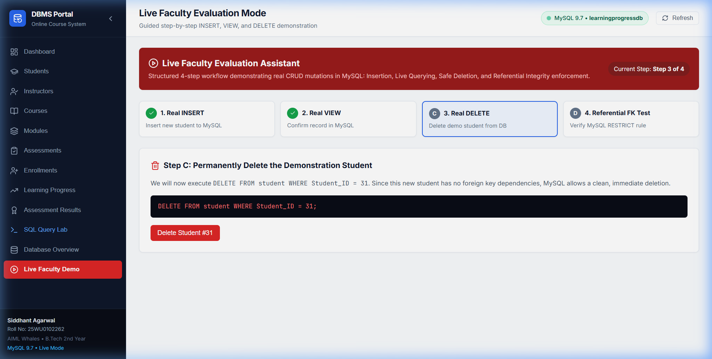
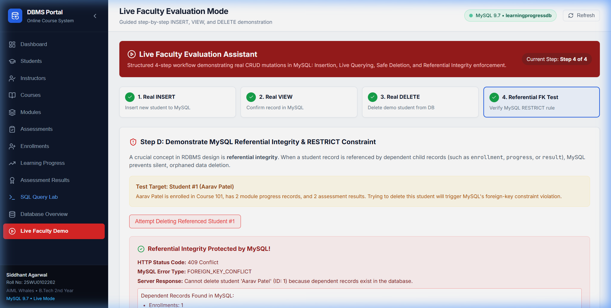
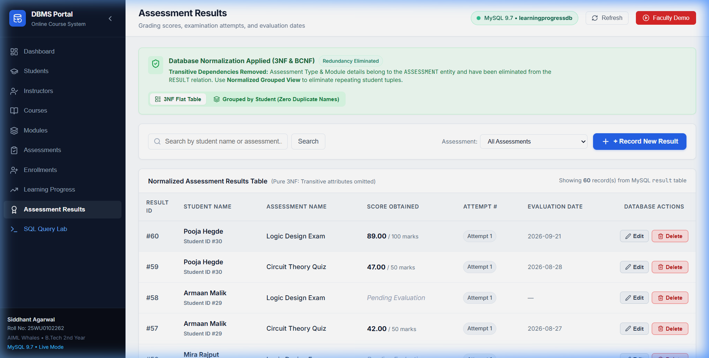
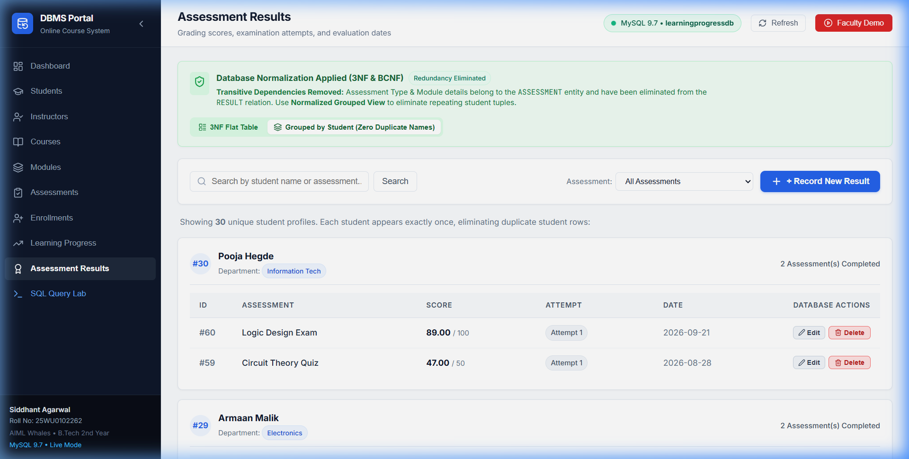
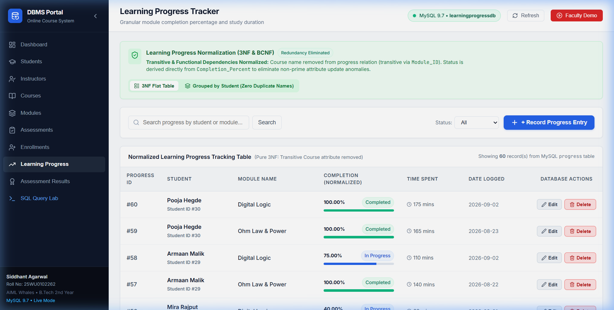
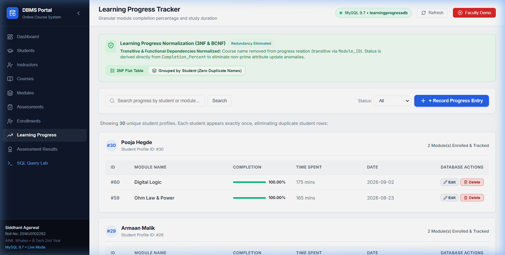
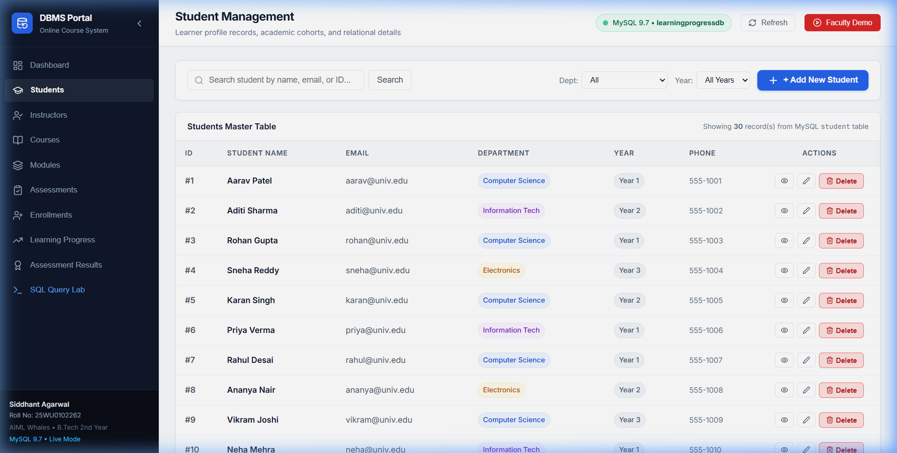

# Presentation III: UI Implementation & Live Faculty Demonstration
## Online Course Learning Progress Management System

**Course:** B.Tech 2nd Year — Database Management Systems (DBMS) Lab Project  
**Team Members:**
- **Siddhant Agarwal** | Roll No: `25WU0102262` | Section: `AIML Whales`
- **Manthena Naga Sri Rohan** | Roll No: `25WU0102151` | Section: `AIML Panthers`

---

### 1. Overview of Presentation III
Presentation III demonstrates the complete full-stack web application connected to a live MySQL 9.7 instance (`learningprogressdb`). Every interface element reflects real-time database state, supports full CRUD mutations, visualizes analytical KPIs, and provides an interactive SQL Query Lab and Faculty Demonstration environment.

**Live Ports:**
- **Frontend Application:** `http://localhost:3000` (React + Vite + TypeScript)
- **Backend REST API:** `http://localhost:5000` (Node.js + Express + `mysql2`)
- **Database Engine:** `MySQL 9.7` on Port `3306`

---

### 2. Faculty Live Evaluation Walkthrough (Demonstration Workflow)

The application features a dedicated **Faculty Live Demo** tab (`/demo`) specifically engineered to prove that the UI is genuinely communicating with MySQL and enforcing ACID constraints:

#### Step A: INSERT — Create New Test Record
- **Action:** Navigate to the Faculty Demo page or Students screen. Fill the student creation form with:
  - `Name`: `Demonstration Student`
  - `Email`: `demo.student@university.edu`
  - `Department`: `Computer Science`
  - `Year`: `2`
- **Database Execution:** `INSERT INTO STUDENT (Name, Email, Department, Year) VALUES (?, ?, ?, ?)`
- **Verification:** The backend returns HTTP `201 Created` with new primary key `Student_ID = 31`. The total student count instantly increments from 30 to 31.
- **Screenshot:** [Step A Form](./screenshots/06_demo_step_a_form.png) & [Step A Inserted](./screenshots/07_demo_step_a_inserted.png)

#### Step B: VIEW — Query the Live Database Record
- **Action:** Query the newly inserted student by ID (`31`).
- **Database Execution:** `SELECT * FROM STUDENT WHERE Student_ID = 31`
- **Verification:** The system displays the real-time record fetched directly from MySQL.
- **Screenshot:** [Step B Queried](./screenshots/08_demo_step_b_queried.png)

#### Step C: DELETE — Safe Removal of Unreferenced Record
- **Action:** Delete the demonstration student (ID `31`).
- **Database Execution:** `DELETE FROM STUDENT WHERE Student_ID = 31`
- **Verification:** Since student #31 has zero foreign-key child dependencies, MySQL executes the deletion. The student list immediately updates, and count returns to 30.
- **Screenshot:** [Step C Deleted](./screenshots/09_demo_step_c_deleted.png)

#### Step D: REFERENTIAL INTEGRITY — FK Constraint Protection
- **Action:** Attempt to delete seeded student `Aarav Sharma` (`Student_ID = 1`).
- **Database Execution:** `DELETE FROM STUDENT WHERE Student_ID = 1`
- **Verification:** MySQL aborts the transaction with error code `ER_ROW_IS_REFERENCED_2` (SQLSTATE `23000`). The backend intercepts this constraint violation and returns HTTP `409 Conflict`. The UI renders a prominent warning modal detailing child dependencies in `ENROLLMENT`, `PROGRESS`, and `RESULT` tables.
- **Screenshot:** [Step D FK Conflict](./screenshots/10_demo_step_d_fk_conflict.png)

---

### 3. Presentation SQL Queries & Verified Results

In the **SQL Query Lab** (`/query-lab`), users can trigger all required presentation queries in real time. Each query returns dynamic row counts, query execution time in milliseconds, and the formatted result matrix.

| Query # | Purpose | SQL Statement | Expected & Verified Result | Screenshot |
| :--- | :--- | :--- | :--- | :--- |
| **Q1** | **First-Year Students** | `SELECT Name, Department, Year FROM STUDENT WHERE Year = 1;` | **Exactly 14 rows** returned from 30 seeded students. | [Query 1 Output](./screenshots/03_query_lab_query1_year1.png) |
| **Q2** | **Instructor-Course JOIN** | `SELECT i.Name AS Instructor_Name, c.Course_Name, c.Category FROM INSTRUCTOR i JOIN COURSE c ON i.Instructor_ID = c.Instructor_ID;` | **Dr. Alan Turing** teaches **exactly 2 courses** (`Intro to Python`, `Database Systems`). | [Query 2 Output](./screenshots/04_query_lab_query2_alan_turing.png) |
| **Q3** | **Student Enrollments** | `SELECT s.Name AS Student_Name, s.Department, c.Course_Name, e.Enrollment_Date FROM ENROLLMENT e JOIN STUDENT s ON e.Student_ID = s.Student_ID JOIN COURSE c ON e.Course_ID = c.Course_ID ORDER BY s.Name;` | Multi-table 3-way JOIN listing active student registrations. | [Students Page](./screenshots/02_students_directory.png) |
| **Q4** | **Learning Progress** | `SELECT s.Name AS Student_Name, c.Course_Name, m.Module_Name, p.Status, p.Completion_Percentage FROM PROGRESS p JOIN STUDENT s ON p.Student_ID = s.Student_ID JOIN MODULE m ON p.Module_ID = m.Module_ID JOIN COURSE c ON m.Course_ID = c.Course_ID;` | 4-table JOIN displaying module completion statuses. | Live in Query Lab |
| **Q5** | **Assessment Scores** | `SELECT s.Name AS Student_Name, a.Title AS Assessment_Title, a.Type, r.Score, a.Max_Marks FROM RESULT r JOIN STUDENT s ON r.Student_ID = s.Student_ID JOIN ASSESSMENT a ON r.Assessment_ID = a.Assessment_ID;` | Evaluation report with calculated percentage marks. | Live in Query Lab |
| **Q6** | **Department Breakdown** | `SELECT Department, COUNT(*) AS Total_Students FROM STUDENT GROUP BY Department ORDER BY Total_Students DESC;` | Aggregated student cohort counts by department. | [Dashboard Analytics](./screenshots/01_dashboard_analytics.png) |
| **Q7** | **Course Completion** | `SELECT c.Course_Name, COUNT(p.Progress_ID) AS Total_Modules_Tracked, ROUND(AVG(p.Completion_Percentage), 2) AS Avg_Completion_Percentage FROM COURSE c JOIN MODULE m ON c.Course_ID = m.Course_ID LEFT JOIN PROGRESS p ON m.Module_ID = p.Module_ID GROUP BY c.Course_ID, c.Course_Name;` | Aggregated completion analytics per course. | [Database Overview](./screenshots/05_database_overview_schema.png) |

---

### 4. Visual Evidence Gallery

#### 1. Interactive KPI Dashboard (`/`)
Displays live metrics calculated via SQL aggregate functions (`COUNT`, `AVG`), Recharts cohort breakdowns, and recent activity feeds.

#### 2. Student Management Directory (`/students`)
Search, filter, pagination, responsive drawer with relational enrollments, progress, and results.

#### 3. Database Schema Overview & Entity Metrics (`/database-overview`)
Live record counts per table, data dictionary introspection from `information_schema.COLUMNS`, and relationship diagram.

#### 4. Faculty Demo — INSERT Phase (`/demo`)

#### 5. Faculty Demo — VIEW & DELETE Phase (`/demo`)

#### 6. Faculty Demo — Foreign Key RESTRICT Protection (`/demo`)

#### 7. Assessment Results — 3NF Normalization & Grouped View (`/results`)
Eliminated transitive dependencies (`Type`, `Module`) and redundant student tuples via hierarchical view. Prominent insert and red delete buttons.

#### 8. Learning Progress — 3NF Normalization & Grouped View (`/progress`)
Eliminated transitive `Course` dependency and redundant non-prime `Status` attribute. Prominent insert and red delete buttons.

#### 9. Students Directory — Visible CRUD Actions (`/students`)
High-visibility blue `+ Add New Student` button and prominent red `Delete` action button on each row.

---

### 5. Browser Session Recording
A complete interactive recording of the web application in action is available in this folder:
- **Video Recording:** [`./screenshots/ui_system_demo.webp`](./screenshots/ui_system_demo.webp)
