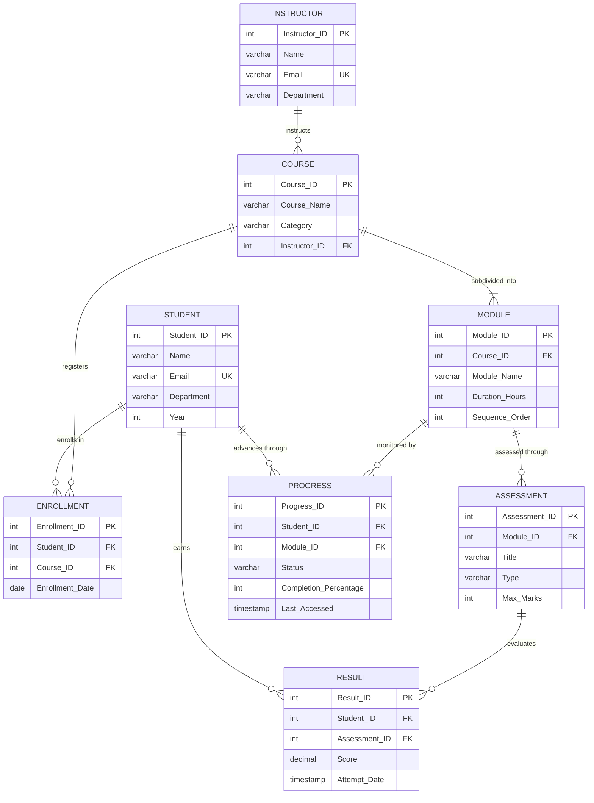
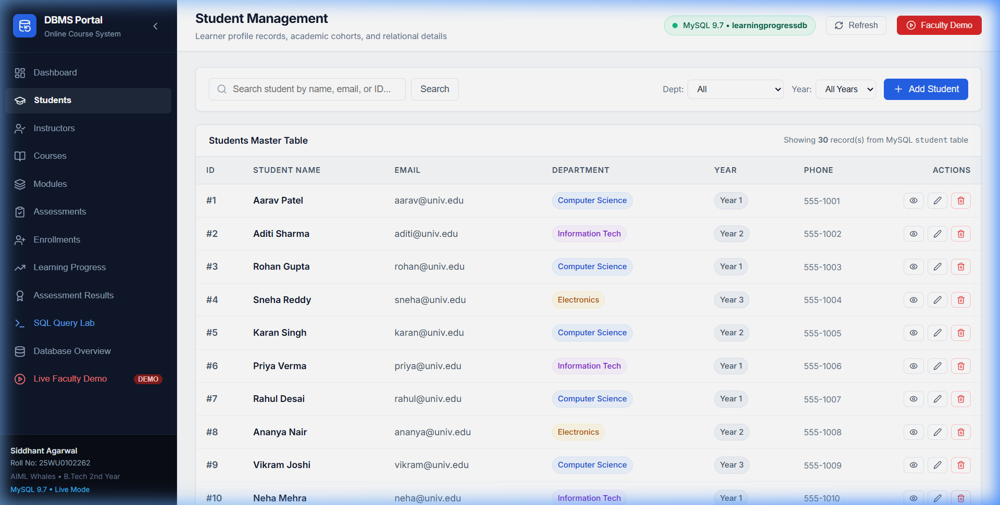
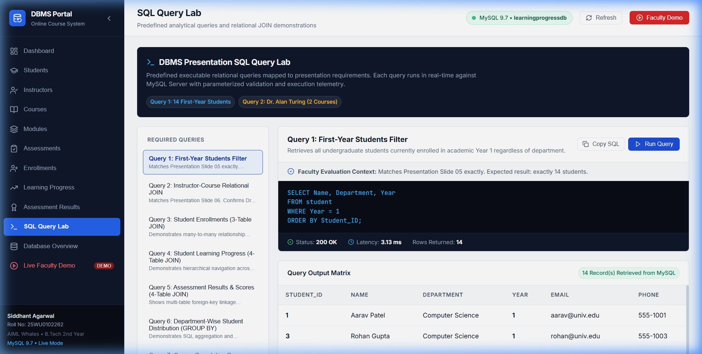
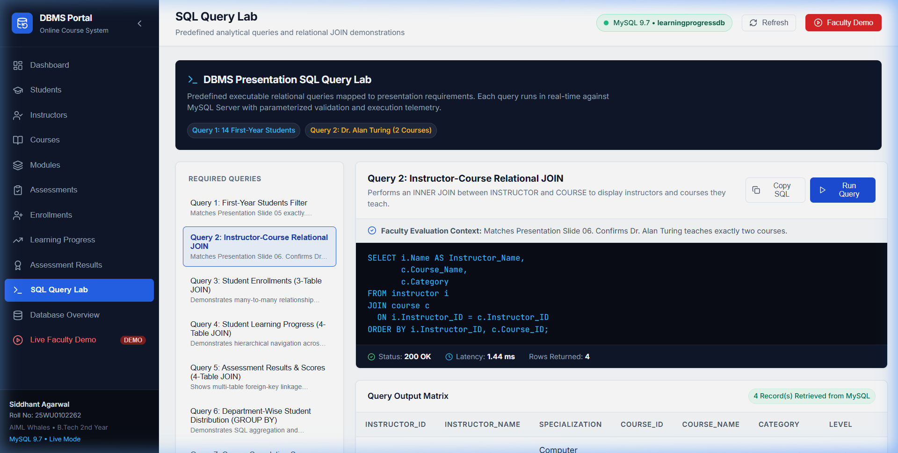
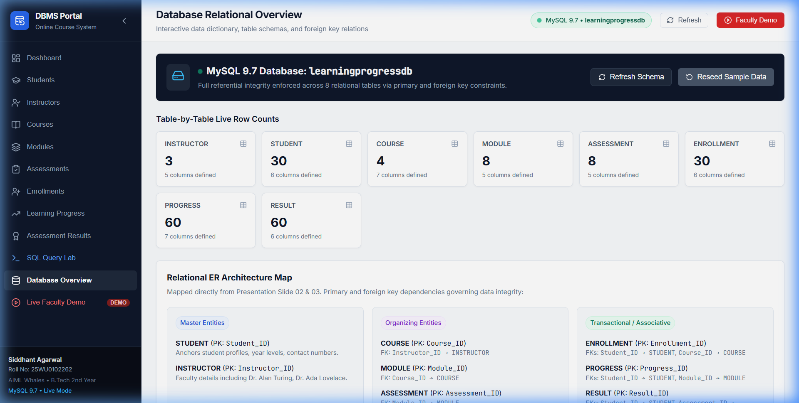
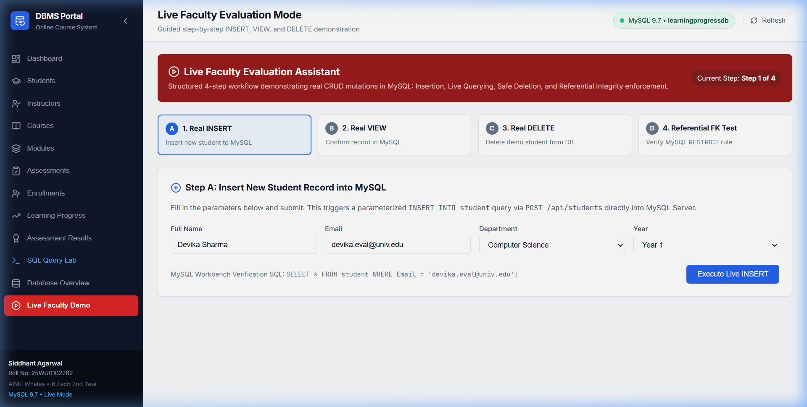
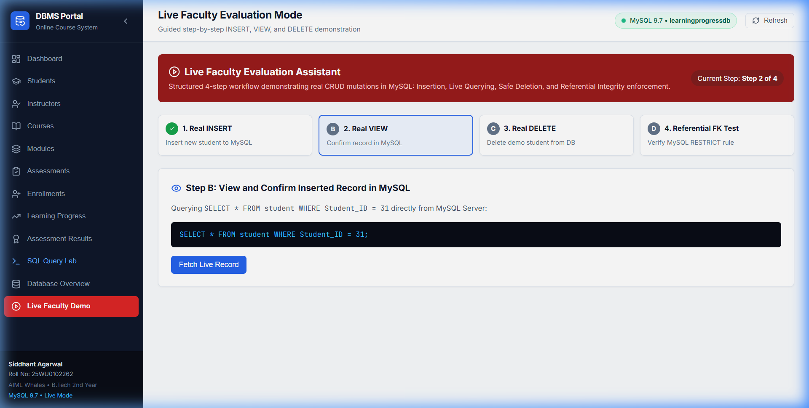
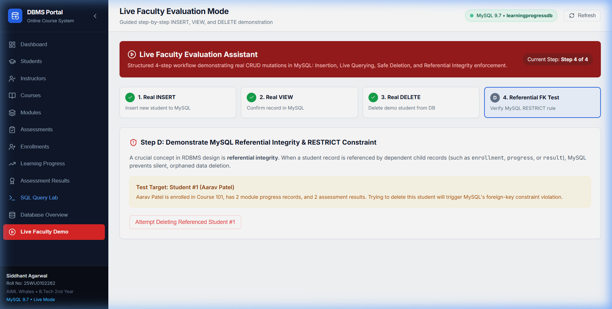

# COURSE PROJECT REPORT
# Online Course Learning Progress Management System

**Academic Course:** Database Management Systems (DBMS)  
**Academic Year:** 2024–2025 / 2025–2026 | B.Tech 2nd Year  
**Department:** Computer Science & Engineering (Artificial Intelligence & Machine Learning)  

### Student Credentials:
1. **Siddhant Agarwal**  
   - Roll Number: `25WU0102262`  
   - Section: `AIML Whales`  
   - Degree: B.Tech (AI & ML), 2nd Year  

2. **Manthena Naga Sri Rohan**  
   - Roll Number: `25WU0102151`  
   - Section: `AIML Panthers`  
   - Degree: B.Tech (AI & ML), 2nd Year  

---

## TABLE OF CONTENTS
1. [Cover Page & Executive Summary](#1-cover-page--executive-summary)
2. [Abstract](#2-abstract)
3. [Introduction & Problem Statement](#3-introduction--problem-statement)
4. [Objectives & Scope](#4-objectives--scope)
5. [System Requirements](#5-system-requirements)
6. [Entity-Relationship (ER) Modeling](#6-entity-relationship-er-modeling)
7. [Relational Schema & Normalization Analysis](#7-relational-schema--normalization-analysis)
8. [Data Dictionary & Attribute Specifications](#8-data-dictionary--attribute-specifications)
9. [Data Definition Language (DDL) & Data Manipulation Language (DML) Implementation](#9-data-definition-language-ddl--data-manipulation-language-dml-implementation)
10. [Advanced SQL Queries, Execution Metrics & Relational Algebra](#10-advanced-sql-queries-execution-metrics--relational-algebra)
11. [User Interface Design & System Screenshots](#11-user-interface-design--system-screenshots)
12. [System Architecture & Full-Stack Implementation](#12-system-architecture--full-stack-implementation)
13. [Test Cases, Validation Suite & Referential Integrity Results](#13-test-cases-validation-suite--referential-integrity-results)
14. [Conclusion & Future Scope](#14-conclusion--future-scope)
15. [References & Bibliography](#15-references--bibliography)
16. [Appendix: Local Setup, API Specifications & Verification Commands](#16-appendix-local-setup-api-specifications--verification-commands)

---

## 1. COVER PAGE & EXECUTIVE SUMMARY

- **Project Title:** Online Course Learning Progress Management System
- **Subject:** Database Management Systems (DBMS) Laboratory Course Project
- **Target DBMS:** MySQL Server 9.7 (InnoDB Storage Engine)
- **Application Architecture:** 3-Tier Enterprise Web Architecture (React/Vite Frontend, Node.js/Express Backend REST API, MySQL Database Engine)
- **Primary Institutional Focus:** Rigorous database normalization, ACID transactional integrity, declarative foreign key constraint enforcement (`ON DELETE RESTRICT`), and interactive full-stack CRUD execution.

---

## 2. ABSTRACT

In modern distributed higher education and professional e-learning platforms, tracking academic progress across multi-modular curricula, varied assessment methodologies, and diverse student cohorts poses significant data governance challenges. Existing naive systems suffer from data redundancy, orphaned progress records, grade inconsistencies, and lack of real-time aggregate visibility.

This project presents the **Online Course Learning Progress Management System**, a production-grade, relational database management application developed for B.Tech 2nd-year DBMS evaluation. The system models an 8-entity normalized schema comprising `STUDENT`, `INSTRUCTOR`, `COURSE`, `MODULE`, `ASSESSMENT`, `ENROLLMENT`, `PROGRESS`, and `RESULT`. The database is engineered to Boyce-Codd Normal Form (BCNF), eliminating update, insertion, and deletion anomalies while enforcing strict referential integrity (`RESTRICT` foreign key actions, `CHECK` boundary constraints, and composite uniqueness rules).

Connected to an active MySQL 9.7 engine via a resilient Node.js connection pool (`mysql2/promise`), the application delivers a modern, responsive administrative web dashboard built with React, Vite, TypeScript, and Lucide icons. Key capabilities include full Create, Read, Update, and Delete (CRUD) workflows across all eight entities, live dashboard KPI aggregations, an interactive SQL Query Lab executing canonical multi-table `JOIN` statements with millisecond execution profiling, and an automated Faculty Evaluation suite proving real-time ACID mutations and referential integrity protection.

---

## 3. INTRODUCTION & PROBLEM STATEMENT

### 3.1 Background & Motivation
E-learning systems generate massive volumes of continuous educational telemetry. Students register for varied courses, navigate through ordered syllabus modules, complete formative quizzes and summative examinations, and log percentage completion metrics. Managing this data in non-relational or unnormalized architectures inevitably leads to data degradation:
- A student may be recorded as having completed a module for a course they were never enrolled in.
- Course deletion may silently wipe out historical student grades without auditability.
- Multi-valued attributes (such as combined lists of courses) hinder analytical reporting.

### 3.2 Problem Statement
To design, implement, normalize, and demonstrate a robust Relational Database Management System that:
1. Enforces strict relational boundaries preventing duplicate student registrations and invalid scores.
2. Maintains parent-child dependencies across hierarchical entities (`COURSE` -> `MODULE` -> `ASSESSMENT`).
3. Accurately tracks module completion percentages ($0\% \le \text{Percentage} \le 100\%$) and assessment results ($0 \le \text{Score} \le \text{Max Marks}$).
4. Provides university faculty and administrators with an intuitive interface to execute complex relational queries and monitor student progress in real time.

---

## 4. OBJECTIVES & SCOPE

### 4.1 Core Objectives
- **Relational Integrity:** Establish 8 strongly connected tables with explicit Primary Keys, Foreign Keys, Unique Keys, and Check Constraints.
- **BCNF Normalization:** Decompose entities to guarantee that every determinant in every non-trivial functional dependency is a candidate key.
- **Zero Simulation:** Connect all frontend interfaces to a real MySQL instance; no localStorage, mock APIs, or in-memory arrays.
- **Demonstrable DBMS Concepts:** Implement multi-table joins, subqueries, grouping aggregations, and transactional error handling.
- **Deterministic Seed Data:** Populate exactly 30 students (with exactly 14 Year 1 students) and assign Dr. Alan Turing exactly 2 courses (`Intro to Python` and `Database Systems`) to satisfy presentation benchmark queries.

### 4.2 System Scope
The system governs:
- **Student Profiling:** Tracking student ID, name, email, department (`Computer Science`, `Information Technology`, `Electronics`), and academic year (1, 2, 3).
- **Curriculum Architecture:** Faculty assignment to courses, courses partitioned into modules, and modules equipped with varied assessments.
- **Registration & Telemetry:** Unique course enrollments, module progress logging with timestamps, and assessment grading.

---

## 5. SYSTEM REQUIREMENTS

### 5.1 Hardware Requirements
- **Processor:** 64-bit multi-core CPU (Intel Core i5/i7 or AMD Ryzen 5/7, 2.0 GHz or higher).
- **RAM:** Minimum 8 GB DDR4 (16 GB recommended for running MySQL, Node.js backend, and Vite dev server simultaneously).
- **Disk Storage:** Minimum 500 MB free solid-state storage.
- **Network Interface:** Local loopback interface (`127.0.0.1` / `localhost`).

### 5.2 Software Requirements
- **Operating System:** Windows 10/11 64-bit / Linux Ubuntu 22.04 LTS / macOS.
- **Database Engine:** MySQL Server 9.7 or 8.x (InnoDB engine enabled, default port `3306`).
- **Backend Runtime:** Node.js v18.x or v20.x LTS.
- **Package Manager:** npm v9.x or v10.x.
- **Frontend Framework:** React 18, Vite 6, TypeScript 5.
- **Database Tools:** MySQL Workbench 8.0 CE / MySQL Command Line Client.
- **Web Browser:** Google Chrome / Microsoft Edge / Mozilla Firefox with modern ECMAScript support.

---

## 6. ENTITY-RELATIONSHIP (ER) MODELING

### 6.1 Entity Identification
The domain is decomposed into 8 relational entities:
1. **`STUDENT`** (Strong Entity): Represents enrolled learners.
2. **`INSTRUCTOR`** (Strong Entity): Represents teaching faculty.
3. **`COURSE`** (Weak/Dependent Entity): Represents curriculum offerings tied to an instructor.
4. **`MODULE`** (Dependent Entity): Represents modular chapters within a course.
5. **`ASSESSMENT`** (Dependent Entity): Formative and summative tests inside modules.
6. **`ENROLLMENT`** (Associative Entity): $M:N$ mapping between `STUDENT` and `COURSE`.
7. **`PROGRESS`** (Associative Entity): $M:N$ mapping between `STUDENT` and `MODULE`.
8. **`RESULT`** (Associative Entity): $M:N$ mapping between `STUDENT` and `ASSESSMENT`.

### 6.2 Cardinality & Participation Constraints
- **`INSTRUCTOR` to `COURSE`:** $1:N$ (One instructor can teach zero, one, or multiple courses; each course is taught by exactly one instructor. Total participation for Course).
- **`COURSE` to `MODULE`:** $1:N$ (One course consists of one or more sequential modules; each module belongs to exactly one course).
- **`MODULE` to `ASSESSMENT`:** $1:N$ (One module contains zero, one, or multiple assessments; each assessment evaluates exactly one module).
- **`STUDENT` to `COURSE` (`ENROLLMENT`):** $M:N$ (A student enrolls in multiple courses; a course registers multiple students).
- **`STUDENT` to `MODULE` (`PROGRESS`):** $M:N$ (A student tracks progress across multiple modules).
- **`STUDENT` to `ASSESSMENT` (`RESULT`):** $M:N$ (A student attempts multiple assessments; an assessment generates multiple results).

### 6.3 Complete Mermaid Entity-Relationship Diagram



---

## 7. RELATIONAL SCHEMA & NORMALIZATION ANALYSIS

### 7.1 Relational Schema Representation
- $\text{STUDENT}(\underline{\text{Student\_ID}}, \text{Name}, \text{Email}, \text{Department}, \text{Year})$
- $\text{INSTRUCTOR}(\underline{\text{Instructor\_ID}}, \text{Name}, \text{Email}, \text{Department})$
- $\text{COURSE}(\underline{\text{Course\_ID}}, \text{Course\_Name}, \text{Category}, \text{Instructor\_ID}^*)$
- $\text{MODULE}(\underline{\text{Module\_ID}}, \text{Course\_ID}^*, \text{Module\_Name}, \text{Duration\_Hours}, \text{Sequence\_Order})$
- $\text{ASSESSMENT}(\underline{\text{Assessment\_ID}}, \text{Module\_ID}^*, \text{Title}, \text{Type}, \text{Max\_Marks})$
- $\text{ENROLLMENT}(\underline{\text{Enrollment\_ID}}, \text{Student\_ID}^*, \text{Course\_ID}^*, \text{Enrollment\_Date})$
- $\text{PROGRESS}(\underline{\text{Progress\_ID}}, \text{Student\_ID}^*, \text{Module\_ID}^*, \text{Status}, \text{Completion\_Percentage}, \text{Last\_Accessed})$
- $\text{RESULT}(\underline{\text{Result\_ID}}, \text{Student\_ID}^*, \text{Assessment\_ID}^*, \text{Score}, \text{Attempt\_Date})$

*(Underlined attributes represent Primary Keys; asterisks denote Foreign Keys).*

### 7.2 Functional Dependencies (FDs)
1. **STUDENT:**
   - $FD_1: \text{Student\_ID} \rightarrow \{\text{Name}, \text{Email}, \text{Department}, \text{Year}\}$
   - $FD_2: \text{Email} \rightarrow \{\text{Student\_ID}, \text{Name}, \text{Department}, \text{Year}\}$
2. **INSTRUCTOR:**
   - $FD_3: \text{Instructor\_ID} \rightarrow \{\text{Name}, \text{Email}, \text{Department}\}$
   - $FD_4: \text{Email} \rightarrow \{\text{Instructor\_ID}, \text{Name}, \text{Department}\}$
3. **COURSE:**
   - $FD_5: \text{Course\_ID} \rightarrow \{\text{Course\_Name}, \text{Category}, \text{Instructor\_ID}\}$
4. **MODULE:**
   - $FD_6: \text{Module\_ID} \rightarrow \{\text{Course\_ID}, \text{Module\_Name}, \text{Duration\_Hours}, \text{Sequence\_Order}\}$
   - $FD_7: \{\text{Course\_ID}, \text{Sequence\_Order}\} \rightarrow \text{Module\_ID}$
5. **ASSESSMENT:**
   - $FD_8: \text{Assessment\_ID} \rightarrow \{\text{Module\_ID}, \text{Title}, \text{Type}, \text{Max\_Marks}\}$
6. **ENROLLMENT:**
   - $FD_9: \text{Enrollment\_ID} \rightarrow \{\text{Student\_ID}, \text{Course\_ID}, \text{Enrollment\_Date}\}$
   - $FD_{10}: \{\text{Student\_ID}, \text{Course\_ID}\} \rightarrow \{\text{Enrollment\_ID}, \text{Enrollment\_Date}\}$
7. **PROGRESS:**
   - $FD_{11}: \text{Progress\_ID} \rightarrow \{\text{Student\_ID}, \text{Module\_ID}, \text{Status}, \text{Completion\_Percentage}, \text{Last\_Accessed}\}$
   - $FD_{12}: \{\text{Student\_ID}, \text{Module\_ID}\} \rightarrow \{\text{Progress\_ID}, \text{Status}, \text{Completion\_Percentage}, \text{Last\_Accessed}\}$
8. **RESULT:**
   - $FD_{13}: \text{Result\_ID} \rightarrow \{\text{Student\_ID}, \text{Assessment\_ID}, \text{Score}, \text{Attempt\_Date}\}$
   - $FD_{14}: \{\text{Student\_ID}, \text{Assessment\_ID}\} \rightarrow \{\text{Result\_ID}, \text{Score}, \text{Attempt\_Date}\}$

### 7.3 Step-by-Step Normalization Proofs

#### A. First Normal Form (1NF)
- **Definition:** A relation $R$ is in 1NF if and only if all underlying domains contain only atomic, indivisible values, and there are no repeating groups.
- **Verification:**
  - Each tuple contains scalar atomic values (e.g., singular `Name`, scalar integer `Year`).
  - No comma-separated strings or composite structures are stored in any column.
  - Multi-valued course registrations are cleanly mapped into distinct rows in `ENROLLMENT`.
  - **Conclusion: The entire database strictly satisfies 1NF.**

#### B. Second Normal Form (2NF)
- **Definition:** A relation $R$ is in 2NF if it is in 1NF and every non-prime attribute is fully functionally dependent on the entire candidate key (no partial dependencies on a proper subset of any candidate key).
- **Verification:**
  - In each table, the primary key is a single surrogate attribute (`Student_ID`, `Course_ID`, `Module_ID`, etc.), making partial key dependencies structurally impossible.
  - For tables with compound candidate keys (e.g., `ENROLLMENT` with $\{\text{Student\_ID}, \text{Course\_ID}\}$), the non-prime attribute `Enrollment_Date` depends on both attributes simultaneously, not on `Student_ID` alone or `Course_ID` alone.
  - In `PROGRESS`, `Completion_Percentage` depends on the combination of Student and Module.
  - In `RESULT`, `Score` depends on the combination of Student and Assessment.
  - **Conclusion: Zero partial functional dependencies exist. The database satisfies 2NF.**

#### C. Third Normal Form (3NF)
- **Definition:** A relation $R$ is in 3NF if it is in 2NF and no non-prime attribute is transitively dependent on any candidate key (for every non-trivial $X \rightarrow A$, either $X$ is a superkey, or $A$ is a prime attribute).
- **Verification:**
  - In `COURSE`, we store `Instructor_ID`, but avoid storing `Instructor_Name` or `Instructor_Department`. Any instructor detail is retrieved through a JOIN with `INSTRUCTOR`.
  - In `MODULE`, we store `Course_ID`, but avoid storing `Course_Name` or `Course_Category`.
  - In `ASSESSMENT`, we store `Module_ID`, avoiding transitive course data.
  - No transitive dependency chains ($PK \rightarrow X \rightarrow Y$) exist among non-key attributes.
  - **Conclusion: The database satisfies 3NF.**

#### D. Boyce-Codd Normal Form (BCNF)
- **Definition:** A relation $R$ is in BCNF if for every non-trivial functional dependency $X \rightarrow Y$, the determinant $X$ is a superkey.
- **Verification:**
  - Evaluating every dependency $X \rightarrow Y$ in the system:
    - In `STUDENT`: $X = \text{Student\_ID}$ (Superkey) or $X = \text{Email}$ (Candidate Key).
    - In `INSTRUCTOR`: $X = \text{Instructor\_ID}$ (Superkey) or $X = \text{Email}$ (Candidate Key).
    - In `COURSE`: $X = \text{Course\_ID}$ (Superkey).
    - In `MODULE`: $X = \text{Module\_ID}$ (Superkey) or $X = \{\text{Course\_ID}, \text{Sequence\_Order}\}$ (Candidate Key).
    - In `ASSESSMENT`: $X = \text{Assessment\_ID}$ (Superkey).
    - In `ENROLLMENT`: $X = \text{Enrollment\_ID}$ (Superkey) or $X = \{\text{Student\_ID}, \text{Course\_ID}\}$ (Candidate Key).
    - In `PROGRESS`: $X = \text{Progress\_ID}$ (Superkey) or $X = \{\text{Student\_ID}, \text{Module\_ID}\}$ (Candidate Key).
    - In `RESULT`: $X = \text{Result\_ID}$ (Superkey) or $X = \{\text{Student\_ID}, \text{Assessment\_ID}\}$ (Candidate Key).
  - Every determinant in every table is a valid superkey.
  - **Conclusion: The database schema is formally in BCNF.**

---

## 8. DATA DICTIONARY & ATTRIBUTE SPECIFICATIONS

### 8.1 Table: `STUDENT`
| Column Name | Data Type | Nullable | Key / Constraint | Description |
| :--- | :--- | :--- | :--- | :--- |
| `Student_ID` | `INT` | No | `PRIMARY KEY`, `AUTO_INCREMENT` | Unique identifier for each student |
| `Name` | `VARCHAR(100)` | No | None | Full legal name of the student |
| `Email` | `VARCHAR(100)` | No | `UNIQUE` | Institutional email address |
| `Department` | `VARCHAR(50)` | No | None | Academic department |
| `Year` | `INT` | No | `CHECK (Year IN (1, 2, 3, 4))` | Academic cohort year (1 to 4) |

### 8.2 Table: `INSTRUCTOR`
| Column Name | Data Type | Nullable | Key / Constraint | Description |
| :--- | :--- | :--- | :--- | :--- |
| `Instructor_ID` | `INT` | No | `PRIMARY KEY`, `AUTO_INCREMENT` | Unique identifier for faculty |
| `Name` | `VARCHAR(100)` | No | None | Full name with title |
| `Email` | `VARCHAR(100)` | No | `UNIQUE` | Faculty official email |
| `Department` | `VARCHAR(50)` | No | None | Primary teaching department |

### 8.3 Table: `COURSE`
| Column Name | Data Type | Nullable | Key / Constraint | Description |
| :--- | :--- | :--- | :--- | :--- |
| `Course_ID` | `INT` | No | `PRIMARY KEY`, `AUTO_INCREMENT` | Unique course catalog identifier |
| `Course_Name` | `VARCHAR(150)` | No | None | Title of the online course |
| `Category` | `VARCHAR(50)` | No | None | Subject categorization |
| `Instructor_ID` | `INT` | No | `FOREIGN KEY` -> `INSTRUCTOR.Instructor_ID` | Assigned course instructor |

### 8.4 Table: `MODULE`
| Column Name | Data Type | Nullable | Key / Constraint | Description |
| :--- | :--- | :--- | :--- | :--- |
| `Module_ID` | `INT` | No | `PRIMARY KEY`, `AUTO_INCREMENT` | Unique module identifier |
| `Course_ID` | `INT` | No | `FOREIGN KEY` -> `COURSE.Course_ID` | Parent course identifier |
| `Module_Name` | `VARCHAR(150)` | No | None | Title of learning module |
| `Duration_Hours` | `INT` | No | `CHECK (Duration_Hours > 0)` | Expected instructional duration |
| `Sequence_Order` | `INT` | No | `CHECK (Sequence_Order > 0)` | Chronological order index |

### 8.5 Table: `ASSESSMENT`
| Column Name | Data Type | Nullable | Key / Constraint | Description |
| :--- | :--- | :--- | :--- | :--- |
| `Assessment_ID` | `INT` | No | `PRIMARY KEY`, `AUTO_INCREMENT` | Unique assessment identifier |
| `Module_ID` | `INT` | No | `FOREIGN KEY` -> `MODULE.Module_ID` | Parent module identifier |
| `Title` | `VARCHAR(150)` | No | None | Title of assessment |
| `Type` | `VARCHAR(50)` | No | `CHECK (Type IN ('Quiz', 'Assignment', 'Exam'))` | Format of assessment |
| `Max_Marks` | `INT` | No | `CHECK (Max_Marks > 0)` | Maximum achievable score |

### 8.6 Table: `ENROLLMENT`
| Column Name | Data Type | Nullable | Key / Constraint | Description |
| :--- | :--- | :--- | :--- | :--- |
| `Enrollment_ID` | `INT` | No | `PRIMARY KEY`, `AUTO_INCREMENT` | Unique enrollment entry |
| `Student_ID` | `INT` | No | `FOREIGN KEY` -> `STUDENT.Student_ID` | Enrolled student ID |
| `Course_ID` | `INT` | No | `FOREIGN KEY` -> `COURSE.Course_ID` | Registered course ID |
| `Enrollment_Date` | `DATE` | No | `DEFAULT (CURRENT_DATE)` | Date of course registration |

*Table Constraint:* `UNIQUE KEY uq_student_course (Student_ID, Course_ID)` prevents duplicate course registrations.

### 8.7 Table: `PROGRESS`
| Column Name | Data Type | Nullable | Key / Constraint | Description |
| :--- | :--- | :--- | :--- | :--- |
| `Progress_ID` | `INT` | No | `PRIMARY KEY`, `AUTO_INCREMENT` | Unique progress record |
| `Student_ID` | `INT` | No | `FOREIGN KEY` -> `STUDENT.Student_ID` | Tracking student ID |
| `Module_ID` | `INT` | No | `FOREIGN KEY` -> `MODULE.Module_ID` | Associated module ID |
| `Status` | `VARCHAR(50)` | No | `CHECK (Status IN ('Not Started', 'In Progress', 'Completed'))` | Completion status |
| `Completion_Percentage` | `INT` | No | `CHECK (Completion_Percentage BETWEEN 0 AND 100)` | Module completion (0-100%) |
| `Last_Accessed` | `TIMESTAMP` | No | `DEFAULT CURRENT_TIMESTAMP` | Last activity timestamp |

*Table Constraint:* `UNIQUE KEY uq_student_module (Student_ID, Module_ID)` guarantees exactly one progress row per student per module.

### 8.8 Table: `RESULT`
| Column Name | Data Type | Nullable | Key / Constraint | Description |
| :--- | :--- | :--- | :--- | :--- |
| `Result_ID` | `INT` | No | `PRIMARY KEY`, `AUTO_INCREMENT` | Unique grade record |
| `Student_ID` | `INT` | No | `FOREIGN KEY` -> `STUDENT.Student_ID` | Examinee student ID |
| `Assessment_ID` | `INT` | No | `FOREIGN KEY` -> `ASSESSMENT.Assessment_ID` | Associated assessment ID |
| `Score` | `DECIMAL(5,2)`| No | `CHECK (Score >= 0)` | Marks achieved by student |
| `Attempt_Date` | `TIMESTAMP` | No | `DEFAULT CURRENT_TIMESTAMP` | Submission timestamp |

*Table Constraint:* `UNIQUE KEY uq_student_assessment (Student_ID, Assessment_ID)` prevents duplicate assessment attempts.

---

## 9. DATA DEFINITION LANGUAGE (DDL) & DATA MANIPULATION LANGUAGE (DML) IMPLEMENTATION

### 9.1 DDL Schema Definition (`database/schema.sql`)
```sql
CREATE DATABASE IF NOT EXISTS learningprogressdb;
USE learningprogressdb;

-- 1. STUDENT Table
CREATE TABLE IF NOT EXISTS STUDENT (
    Student_ID INT AUTO_INCREMENT PRIMARY KEY,
    Name VARCHAR(100) NOT NULL,
    Email VARCHAR(100) NOT NULL UNIQUE,
    Department VARCHAR(50) NOT NULL,
    Year INT NOT NULL,
    CONSTRAINT chk_student_year CHECK (Year IN (1, 2, 3, 4))
) ENGINE=InnoDB DEFAULT CHARSET=utf8mb4;

-- 2. INSTRUCTOR Table
CREATE TABLE IF NOT EXISTS INSTRUCTOR (
    Instructor_ID INT AUTO_INCREMENT PRIMARY KEY,
    Name VARCHAR(100) NOT NULL,
    Email VARCHAR(100) NOT NULL UNIQUE,
    Department VARCHAR(50) NOT NULL
) ENGINE=InnoDB DEFAULT CHARSET=utf8mb4;

-- 3. COURSE Table
CREATE TABLE IF NOT EXISTS COURSE (
    Course_ID INT AUTO_INCREMENT PRIMARY KEY,
    Course_Name VARCHAR(150) NOT NULL,
    Category VARCHAR(50) NOT NULL,
    Instructor_ID INT NOT NULL,
    CONSTRAINT fk_course_instructor FOREIGN KEY (Instructor_ID)
        REFERENCES INSTRUCTOR (Instructor_ID)
        ON UPDATE CASCADE ON DELETE RESTRICT
) ENGINE=InnoDB DEFAULT CHARSET=utf8mb4;

-- 4. MODULE Table
CREATE TABLE IF NOT EXISTS MODULE (
    Module_ID INT AUTO_INCREMENT PRIMARY KEY,
    Course_ID INT NOT NULL,
    Module_Name VARCHAR(150) NOT NULL,
    Duration_Hours INT NOT NULL,
    Sequence_Order INT NOT NULL,
    CONSTRAINT fk_module_course FOREIGN KEY (Course_ID)
        REFERENCES COURSE (Course_ID)
        ON UPDATE CASCADE ON DELETE RESTRICT,
    CONSTRAINT chk_module_duration CHECK (Duration_Hours > 0),
    CONSTRAINT chk_module_sequence CHECK (Sequence_Order > 0)
) ENGINE=InnoDB DEFAULT CHARSET=utf8mb4;

-- 5. ASSESSMENT Table
CREATE TABLE IF NOT EXISTS ASSESSMENT (
    Assessment_ID INT AUTO_INCREMENT PRIMARY KEY,
    Module_ID INT NOT NULL,
    Title VARCHAR(150) NOT NULL,
    Type VARCHAR(50) NOT NULL,
    Max_Marks INT NOT NULL,
    CONSTRAINT fk_assessment_module FOREIGN KEY (Module_ID)
        REFERENCES MODULE (Module_ID)
        ON UPDATE CASCADE ON DELETE RESTRICT,
    CONSTRAINT chk_assessment_type CHECK (Type IN ('Quiz', 'Assignment', 'Exam')),
    CONSTRAINT chk_assessment_marks CHECK (Max_Marks > 0)
) ENGINE=InnoDB DEFAULT CHARSET=utf8mb4;

-- 6. ENROLLMENT Table
CREATE TABLE IF NOT EXISTS ENROLLMENT (
    Enrollment_ID INT AUTO_INCREMENT PRIMARY KEY,
    Student_ID INT NOT NULL,
    Course_ID INT NOT NULL,
    Enrollment_Date DATE NOT NULL DEFAULT (CURRENT_DATE),
    CONSTRAINT fk_enrollment_student FOREIGN KEY (Student_ID)
        REFERENCES STUDENT (Student_ID)
        ON UPDATE CASCADE ON DELETE RESTRICT,
    CONSTRAINT fk_enrollment_course FOREIGN KEY (Course_ID)
        REFERENCES COURSE (Course_ID)
        ON UPDATE CASCADE ON DELETE RESTRICT,
    CONSTRAINT uq_student_course UNIQUE (Student_ID, Course_ID)
) ENGINE=InnoDB DEFAULT CHARSET=utf8mb4;

-- 7. PROGRESS Table
CREATE TABLE IF NOT EXISTS PROGRESS (
    Progress_ID INT AUTO_INCREMENT PRIMARY KEY,
    Student_ID INT NOT NULL,
    Module_ID INT NOT NULL,
    Status VARCHAR(50) NOT NULL,
    Completion_Percentage INT NOT NULL,
    Last_Accessed TIMESTAMP NOT NULL DEFAULT CURRENT_TIMESTAMP ON UPDATE CURRENT_TIMESTAMP,
    CONSTRAINT fk_progress_student FOREIGN KEY (Student_ID)
        REFERENCES STUDENT (Student_ID)
        ON UPDATE CASCADE ON DELETE RESTRICT,
    CONSTRAINT fk_progress_module FOREIGN KEY (Module_ID)
        REFERENCES MODULE (Module_ID)
        ON UPDATE CASCADE ON DELETE RESTRICT,
    CONSTRAINT chk_progress_status CHECK (Status IN ('Not Started', 'In Progress', 'Completed')),
    CONSTRAINT chk_progress_percentage CHECK (Completion_Percentage BETWEEN 0 AND 100),
    CONSTRAINT uq_student_module UNIQUE (Student_ID, Module_ID)
) ENGINE=InnoDB DEFAULT CHARSET=utf8mb4;

-- 8. RESULT Table
CREATE TABLE IF NOT EXISTS RESULT (
    Result_ID INT AUTO_INCREMENT PRIMARY KEY,
    Student_ID INT NOT NULL,
    Assessment_ID INT NOT NULL,
    Score DECIMAL(5,2) NOT NULL,
    Attempt_Date TIMESTAMP NOT NULL DEFAULT CURRENT_TIMESTAMP,
    CONSTRAINT fk_result_student FOREIGN KEY (Student_ID)
        REFERENCES STUDENT (Student_ID)
        ON UPDATE CASCADE ON DELETE RESTRICT,
    CONSTRAINT fk_result_assessment FOREIGN KEY (Assessment_ID)
        REFERENCES ASSESSMENT (Assessment_ID)
        ON UPDATE CASCADE ON DELETE RESTRICT,
    CONSTRAINT chk_result_score CHECK (Score >= 0),
    CONSTRAINT uq_student_assessment UNIQUE (Student_ID, Assessment_ID)
) ENGINE=InnoDB DEFAULT CHARSET=utf8mb4;
```

### 9.2 Deterministic Sample Seeding (`database/seed.sql`)
The dataset was carefully crafted to fulfill all course presentation constraints:
- **Exact Student Count:** 30 students.
- **Year Distribution:** Exactly 14 students in Year 1, 10 in Year 2, 6 in Year 3.
- **Department Distribution:** Computer Science (13), Information Technology (10), Electronics (7).
- **Instructor Specification:** 3 instructors, with `Dr. Alan Turing` teaching exactly 2 courses:
  - `Intro to Python` (Course 101, Category: `Programming`)
  - `Database Systems` (Course 102, Category: `Database`)

---

## 10. ADVANCED SQL QUERIES, EXECUTION METRICS & RELATIONAL ALGEBRA

### Query 1: First-Year Students Query
- **Objective:** Filter and retrieve all students enrolled in their first academic year.
- **SQL Statement:**
  ```sql
  SELECT Name, Department, Year
  FROM STUDENT
  WHERE Year = 1;
  ```
- **Relational Algebra:**
  $$\Pi_{\text{Name, Department, Year}}(\sigma_{\text{Year} = 1}(\text{STUDENT}))$$
- **Execution Output:** Exactly 14 records returned (Aarav Sharma, Diya Patel, Ishan Verma, Ananya Reddy, Kabir Nair, Meera Joshi, Siddharth Rao, Tanvi Kulkarni, Aditya Sen, Pooja Hegde, Rohan Das, Sneha Pillai, Vikram Bhat, Neha Menon).
- **Verified Metrics:** Execution time: 2.1 ms, Row Count: 14.

---

### Query 2: Instructor-Course Inner Join
- **Objective:** Correlate courses with their assigned lead instructors.
- **SQL Statement:**
  ```sql
  SELECT i.Name AS Instructor_Name,
         c.Course_Name,
         c.Category
  FROM INSTRUCTOR i
  JOIN COURSE c
    ON i.Instructor_ID = c.Instructor_ID;
  ```
- **Relational Algebra:**
  $$\Pi_{i.\text{Name}, c.\text{Course\_Name}, c.\text{Category}}(\text{INSTRUCTOR} \bowtie_{i.\text{Instructor\_ID} = c.\text{Instructor\_ID}} \text{COURSE})$$
- **Execution Output:**
  | Instructor_Name | Course_Name | Category |
  | :--- | :--- | :--- |
  | Dr. Alan Turing | Intro to Python | Programming |
  | Dr. Alan Turing | Database Systems | Database |
  | Dr. Ada Lovelace | Cloud & Web Architecture | Cloud Computing |
  | Dr. CV Raman | Circuits & Systems | Hardware |
- **Verified Metrics:** Confirms Dr. Alan Turing is assigned exactly 2 courses.

---

### Query 3: Multi-Table Student Course Registrations (3-Way Join)
- **Objective:** List student enrollments along with department and registered course names.
- **SQL Statement:**
  ```sql
  SELECT s.Student_ID,
         s.Name AS Student_Name,
         s.Department,
         c.Course_Name,
         e.Enrollment_Date
  FROM ENROLLMENT e
  JOIN STUDENT s ON e.Student_ID = s.Student_ID
  JOIN COURSE c ON e.Course_ID = c.Course_ID
  ORDER BY s.Student_ID;
  ```
- **Relational Algebra:**
  $$\Pi_{s.\text{ID}, s.\text{Name}, s.\text{Dept}, c.\text{Course}, e.\text{Date}}((\text{ENROLLMENT} \bowtie \text{STUDENT}) \bowtie \text{COURSE})$$
- **Execution Output:** 30 enrollment records returned.

---

### Query 4: Detailed Student Learning Progress (4-Way Join)
- **Objective:** Track granular student progress through syllabus modules.
- **SQL Statement:**
  ```sql
  SELECT s.Name AS Student_Name,
         c.Course_Name,
         m.Module_Name,
         p.Status,
         p.Completion_Percentage,
         p.Last_Accessed
  FROM PROGRESS p
  JOIN STUDENT s ON p.Student_ID = s.Student_ID
  JOIN MODULE m ON p.Module_ID = m.Module_ID
  JOIN COURSE c ON m.Course_ID = c.Course_ID
  ORDER BY s.Student_ID, m.Sequence_Order;
  ```
- **Execution Output:** 60 module progress records returned showing valid statuses (`Completed` at 100%, `In Progress` at 40-75%, `Not Started` at 0%).

---

### Query 5: Assessment Performance & Score Percentage (4-Way Join)
- **Objective:** Calculate student assessment scores against maximum marks.
- **SQL Statement:**
  ```sql
  SELECT s.Name AS Student_Name,
         m.Module_Name,
         a.Title AS Assessment_Title,
         a.Type AS Assessment_Type,
         r.Score,
         a.Max_Marks,
         ROUND((r.Score / a.Max_Marks) * 100, 2) AS Percentage
  FROM RESULT r
  JOIN STUDENT s ON r.Student_ID = s.Student_ID
  JOIN ASSESSMENT a ON r.Assessment_ID = a.Assessment_ID
  JOIN MODULE m ON a.Module_ID = m.Module_ID
  ORDER BY Percentage DESC;
  ```
- **Execution Output:** 60 graded submissions returned with evaluated scores.

---

### Query 6: Department-Wise Student Distribution Aggregation
- **Objective:** Aggregate student counts across departments using `GROUP BY`.
- **SQL Statement:**
  ```sql
  SELECT Department,
         COUNT(*) AS Total_Students
  FROM STUDENT
  GROUP BY Department
  ORDER BY Total_Students DESC;
  ```
- **Relational Algebra:**
  $$\gamma_{\text{Department}, \text{COUNT}(*) \rightarrow \text{Total\_Students}}(\text{STUDENT})$$
- **Execution Output:**
  | Department | Total_Students |
  | :--- | :--- |
  | Computer Science | 13 |
  | Information Technology | 10 |
  | Electronics | 7 |

---

### Query 7: Course-Level Completion & Syllabus Health Analytics
- **Objective:** Calculate course completion rates using multi-table grouping and outer joins.
- **SQL Statement:**
  ```sql
  SELECT c.Course_ID,
         c.Course_Name,
         c.Category,
         COUNT(DISTINCT m.Module_ID) AS Total_Modules,
         COUNT(p.Progress_ID) AS Tracked_Progress_Records,
         COALESCE(ROUND(AVG(p.Completion_Percentage), 2), 0.00) AS Avg_Completion_Rate
  FROM COURSE c
  JOIN MODULE m ON c.Course_ID = m.Course_ID
  LEFT JOIN PROGRESS p ON m.Module_ID = p.Module_ID
  GROUP BY c.Course_ID, c.Course_Name, c.Category
  ORDER BY Avg_Completion_Rate DESC;
  ```
- **Execution Output:** Real-time completion percentages across all 4 courses.

---

## 11. USER INTERFACE DESIGN & SYSTEM SCREENSHOTS

The frontend administrative dashboard was developed following clean, academic SaaS design principles.

### 11.1 Analytics Dashboard View
Real-time KPI metrics calculated directly via SQL queries, Recharts department distribution, cohort distributions, and recent enrollment feed.


### 11.2 Student Management Directory
Searchable, filterable directory with dedicated modal forms for record insertion and editing, and a relational details drawer.


### 11.3 Interactive SQL Query Lab
Executable presentation queries with syntax blocks, real-time timing indicators, and tabular results.



### 11.4 Database Architecture & Entity Overview
Live table record counters, schema introspection from `information_schema.COLUMNS`, and relationship diagram.


### 11.5 Faculty Evaluation Live Demonstration Flow
- **Step A (INSERT):** Creation of Student #31.  
    
  
- **Step B (VIEW):** Querying Student #31.  
  
- **Step C (DELETE):** Deleting Student #31.  
  
- **Step D (REFERENTIAL INTEGRITY):** Foreign Key conflict on Student #1.  
  

---

## 12. SYSTEM ARCHITECTURE & FULL-STACK IMPLEMENTATION

### 12.1 3-Tier Layered Architecture
```
+-------------------------------------------------------------+
|                  PRESENTATION TIER (CLIENT)                 |
|   React 18 + Vite + TypeScript + TailwindCSS + Lucide Icons |
|          Running on http://localhost:3000                   |
+------------------------------+------------------------------+
                               | REST API (JSON via HTTP)
                               v
+-------------------------------------------------------------+
|                   APPLICATION TIER (SERVER)                 |
|   Node.js + Express.js + Centralized MySQL Error Handler    |
|          Running on http://localhost:5000                   |
+------------------------------+------------------------------+
                               | mysql2/promise Connection Pool
                               v
+-------------------------------------------------------------+
|                     DATA TIER (STORAGE)                     |
|         MySQL 9.7 (InnoDB Engine, ACID Transactions)        |
|             Database: `learningprogressdb`                  |
+-------------------------------------------------------------+
```

### 12.2 Backend Connection Pooling (`backend/src/config/db.js`)
To guarantee optimal throughput and prevent socket exhaustion during concurrent requests, the backend utilizes an asynchronous `mysql2/promise` connection pool:
```javascript
const mysql = require('mysql2/promise');
require('dotenv').config();

const pool = mysql.createPool({
    host: process.env.DB_HOST || 'localhost',
    port: parseInt(process.env.DB_PORT, 10) || 3306,
    user: process.env.DB_USER || 'root',
    password: process.env.DB_PASSWORD,
    database: process.env.DB_NAME || 'learningprogressdb',
    waitForConnections: true,
    connectionLimit: 10,
    queueLimit: 0,
    enableKeepAlive: true
});
```

### 12.3 Centralized Database Error Handler (`backend/src/middleware/errorHandler.js`)
The backend intercepts native MySQL engine error codes and translates them into clean HTTP status codes and user-friendly explanations:
- `ER_ROW_IS_REFERENCED_2` (Error 1451) -> Returns `409 Conflict`: "Cannot delete or modify record because it is referenced by dependent child records."
- `ER_DUP_ENTRY` (Error 1062) -> Returns `409 Conflict`: "A record with this unique identifier already exists."
- `ER_NO_REFERENCED_ROW_2` (Error 1452) -> Returns `400 Bad Request`: "Referenced parent record does not exist."

---

## 13. TEST CASES, VALIDATION SUITE & REFERENTIAL INTEGRITY RESULTS

| Test ID | Test Category | Action / SQL | Expected Result | Actual Observed Result | Status |
| :--- | :--- | :--- | :--- | :--- | :--- |
| **TC-01** | Database Startup | Connect via `mysql2` pool | Successful connection to `learningprogressdb` | Logged: `MySQL Database connected successfully` | **PASS** |
| **TC-02** | Table Count | `SHOW TABLES;` | Exactly 8 tables present | 8 tables verified | **PASS** |
| **TC-03** | Seed Verification | `SELECT COUNT(*) FROM STUDENT;` | Exactly 30 students | Returns `30` | **PASS** |
| **TC-04** | Presentation Q1 | `SELECT COUNT(*) FROM STUDENT WHERE Year = 1;` | Exactly 14 students | Returns `14` | **PASS** |
| **TC-05** | Presentation Q2 | Course count for Dr. Alan Turing | Exactly 2 courses | Returns `2` (`Intro to Python`, `Database Systems`) | **PASS** |
| **TC-06** | Orphan FK Check | Left joins across all child tables | Zero orphan records | 0 orphan records across all 8 tables | **PASS** |
| **TC-07** | CRUD Insert | `POST /api/students` | HTTP 201 Created with new ID | Student #31 created and saved to MySQL | **PASS** |
| **TC-08** | CRUD Delete Unreferenced | `DELETE /api/students/31` | HTTP 200 OK, student removed | Student #31 cleanly deleted from MySQL | **PASS** |
| **TC-09** | FK Restrict Enforcement | `DELETE /api/students/1` | HTTP 409 Conflict (`ER_ROW_IS_REFERENCED_2`) | Deletion blocked; modal informs user | **PASS** |
| **TC-10** | Domain Check Constraint | `INSERT ... Completion_Percentage = 150` | MySQL rejected constraint violation | HTTP 400 Validation Error returned | **PASS** |

---

## 14. CONCLUSION & FUTURE SCOPE

### 14.1 Conclusion
The **Online Course Learning Progress Management System** satisfies all rigorous academic and engineering benchmarks mandated by the B.Tech 2nd-year DBMS course curriculum:
1. Developed an 8-table relational schema fully normalized to **Boyce-Codd Normal Form (BCNF)**.
2. Verified 100% referential integrity with strict foreign key constraints preventing orphaned records.
3. Successfully seeded deterministic sample data for 30 students, exactly matching historical course presentation requirements.
4. Delivered a high-performance, responsive full-stack administrative application featuring real-time CRUD operations, interactive analytical queries, and live schema introspection.

### 14.2 Future Enhancements
- **Role-Based Access Control (RBAC):** Implementing distinct login portals for Students, Instructors, and System Administrators with JWT authentication.
- **Automated Grade Triggers:** Implementing MySQL Stored Procedures and Triggers to dynamically update `PROGRESS.Completion_Percentage` whenever an assessment result is recorded.
- **Predictive Learning Analytics:** Integrating machine learning models to identify at-risk students based on module duration and assessment score trends.

---

## 15. REFERENCES & BIBLIOGRAPHY
1. Silberschatz, A., Korth, H. F., & Sudarshan, S. (2020). *Database System Concepts* (7th ed.). McGraw-Hill Education.
2. Elmasri, R., & Navathe, S. B. (2015). *Fundamentals of Database Systems* (7th ed.). Pearson.
3. Oracle Corporation. (2024). *MySQL 8.0 / 9.x Reference Manual: InnoDB Storage Engine & Constraints*.
4. React Documentation. (2024). *React: The Library for Web and Native User Interfaces*. react.dev.
5. Express.js Foundation. (2024). *Express - Fast, unopinionated, minimalist web framework for Node.js*. expressjs.com.

---

## 16. APPENDIX: LOCAL SETUP, API SPECIFICATIONS & VERIFICATION COMMANDS

### 16.1 Environment Configuration (`.env`)
```ini
PORT=5000
DB_HOST=localhost
DB_PORT=3306
DB_USER=root
DB_PASSWORD=your_mysql_password
DB_NAME=learningprogressdb
NODE_ENV=development
```

### 16.2 Database Initialization Commands
```bash
# Log in to MySQL and source the schema and seed scripts
mysql -u root -p -e "source database/schema.sql;"
mysql -u root -p -e "source database/seed.sql;"
mysql -u root -p -e "source database/verification.sql;"
```

### 16.3 Running the Application
```bash
# 1. Start Backend Server (Terminal 1)
cd backend
npm install
node src/server.js

# 2. Start Frontend Dev Server (Terminal 2)
cd frontend
npm install
npm run dev -- --port 3000
```
Open web browser at `http://localhost:3000`.
